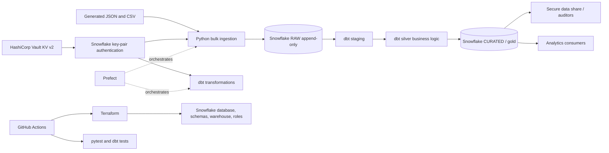

# Architecture

## Design principles

- RAW ingestion is append-only; repeated runs may produce duplicate records. Deduplication belongs downstream in dbt.
- Synthetic records only. SSNs are test fixtures, never real customer information.
- Terraform creates infrastructure; the loader creates RAW tables (see `sql/raw_table.sql` for an explicit DDL alternative).
- Separate CI Snowflake resources from production. Never expose real customer data to pull-request workflows.
- Vault holds the private key; the public key is registered on the Snowflake user.
